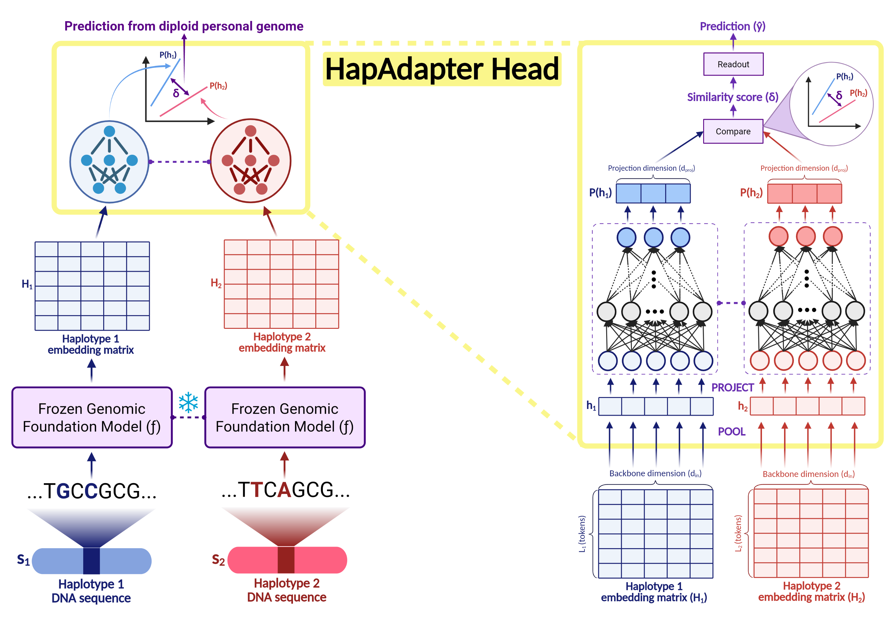

# HapAdapter
### A Transfer Learning Protocol for Genomic Foundation Models Adapted to Diploid Personal Epigenomes

A protocol for adapting any DNA foundation model to personal diploid genome inference. The adapter is a "siamese" network that can be trained to predict a functional track (e.g. the presence of allele-specific activity at a variant) from the extracted final-layer (haplotype 1, haplotype 2) embeddings provided by a frozen genomic foundation model.



**Trained models** for 11 assays across 4 EN-TEx individuals on a DNABERT-2 backbone are published on Hugging Face:
[HapAdapter collection](https://huggingface.co/collections/ametrick-system/hapadapter).

---

HapAdapter fits a small siamese/twin contrast head on top of a frozen genomic
foundation model. Two sequence windows share one encoder and one projection, and the call is
a logistic function of the distance between their projected representations:

```
s = ||z1 - z2||            contrast distance
p = sigma(a * s + b)       a = softplus(a_raw) >= 0
```

so a larger representational distance between the two windows gives a higher probability.

The task in the accompanying paper is **allele-specific binding**: the two windows are a
donor's two haplotypes at a heterozygous SNV, and the label is whether binding is
allele-specific.
---

## What you need

To fit a head you need a dataset of **sequence pairs with a binary label**:

| | Column | Notes |
|---|---|---|
| **Required** | `sequence1`, `sequence2` | the two windows to contrast. They must not be identical at every row — the fitter refuses a build where they are, since the contrast would be identically zero |
| **Required** | a label column (`--label_col`, default `label`) | binary, 0/1 |
| **Required** | chromosome and position, in the `.meta.csv` sidecar | used for splitting and for joining scores back to loci |
| *Optional* | a precision weight (`--depth_col`, default `depth`) | a per-row confidence in the label. Absent, every row is weighted equally |

---

## Install

```bash
conda create -n eb2 python=3.8 && conda activate eb2

pip install -e .                 # core: dataset building only (no torch)
pip install -e ".[model]"        # + torch, transformers, safetensors, peft -> training and scoring
pip install -e ".[analysis]"     # + matplotlib, logomaker, memelite -> figures
pip install -e ".[alphagenome]"  # + alphagenome -> the AlphaGenome backbone
pip install -e ".[all]"          # model + analysis (not alphagenome)
```

`import hapadapter` works in an environment without torch and only pulls a dependency when
you touch a name that needs it:

```python
from hapadapter import build_dataset              # needs pyBigWig, not torch
from hapadapter import load_model_and_tokenizer   # needs torch
```

---

## Quickstart — fit a head

The dataset build is **config-driven**: `data/build_experiment.py` reads a YAML config and
writes `train/dev/test.csv` plus `.meta.csv` sidecars and `experiment_config.json`.

```bash
python -m hapadapter.data.build_experiment configs/asb.yaml \
    --ref_fasta "$REF" --output_dir "$BUILD"

python -m hapadapter.fit_adapter --backend sequence \
    --build_dir "$BUILD" --init_backbone_from "$ENCODER" \
    --proj_dim 128 --head_num_layers 2 --head_hidden_size 128 \
    --balanced_sampler --epochs 3 --lr 1e-3 --out_dir "$HEAD"
```

`$ENCODER` is any checkpoint directory the package can load — a stock foundation model, or
one you have fine-tuned (see [Fine-tuning the trunk](#fine-tuning-the-trunk-optional)). It is
frozen either way.

### The two backends

They fit the same head with the same loss, and differ only in where the embeddings come
from:

| Backend | Input | Requires |
|---|---|---|
| `--backend cached` | precomputed pooled embeddings (`.npz`) | **CPU only**. Works with any backbone, including ones that are not torch models — AlphaGenome runs in JAX, in a separate environment |
| `--backend sequence` | the build's sequence CSVs, with a live but frozen encoder | GPU + `transformers` |

### Loading a trained model

```python
from hapadapter.loading import load_model_and_tokenizer
model, tokenizer, run_config = load_model_and_tokenizer("path/to/checkpoint")
model.eval()
```

A published checkpoint is loaded the same way, after fetching both subfolders — the head
carries no encoder and resolves one from the sibling trunk:

```python
from huggingface_hub import snapshot_download
from hapadapter.loading import load_model_and_tokenizer

local = snapshot_download("ametrick-system/hapadapter-as-ctcf",
                          allow_patterns="ENC-002/dnabert2-*/*")
model, tokenizer, run_config = load_model_and_tokenizer(
    f"{local}/ENC-002/dnabert2-personal")
```

This is **not** an `AutoModel`; the twin head consumes two pooled embeddings, so loading goes
through the package.

---

## Head arguments (`hapadapter.fit_adapter`)

| Argument | Values | Meaning |
|---|---|---|
| `--backend` | `cached` \| `sequence` | Precomputed embeddings (CPU) or a live frozen encoder (GPU). Required. |
| `--build_dir` | path | `sequence`: the dataset build to train from. |
| `--train_cache` / `--dev_cache` / `--test_cache` | path | `cached`: the pooled-embedding `.npz` per split. Each needs its `--*_pair` and `--*_meta` CSV alongside. |
| `--init_backbone_from` | path | `sequence`: the encoder directory. Its weights initialise the frozen encoder and its `run_config` supplies the pooling settings. |
| `--backbone` | str | `sequence`: override the backbone recorded in the encoder's `run_config`, for when that path has moved. |
| `--label_col` | str (default `label`) | The binary label column in the pair CSV. |
| `--depth_col` | str (default `depth`) | Per-row precision weight. Absent from the build, weights are uniform. |
| `--cov_col` | str (default `total_reads`) | Coverage column in the meta table, used by the scoring utilities. |
| `--head_variant` | `twin` | Head topology. The only option. |
| `--proj_dim` | int (default 128) | Width of the shared projection that forms the contrast distance. |
| `--head_num_layers` | int (default 2) | 1 = linear; >= 2 = MLP with `--head_hidden_size`. |
| `--head_hidden_size` | int (default 128) | MLP hidden width. |
| `--head_activation` | `gelu` \| `relu` \| `tanh` \| `silu` (default `gelu`) | MLP activation. Inert at `head_num_layers = 1`. |
| `--head_dropout` / `--pool_dropout` | float | Dropout on the head and on the pooled embedding (train-time only). |
| `--neff_s` | float (default 20.0) | Saturation cap `s` for the precision weight. Must be > 0. Loss-only. |
| `--balanced_sampler` | flag | Class-balanced batches. Do **not** also subsample the data. |
| `--epochs` / `--lr` / `--batch_size` / `--weight_decay` / `--seed` | | Optimization. |
| `--eval_strategy` / `--eval_steps` / `--save_steps` | | Evaluation cadence. |
| `--n_boot` | int | Bootstrap draws for the reported confidence interval. |
| `--backbone_label` | str | Free-text tag recorded in `run_config.json`, for telling arms apart later. |
| `--out_dir` | path | Where the head and its `run_config.json` are written. |

Training writes `run_config.json` alongside the weights; `hapadapter.loading` reads it back to
reconstruct the exact architecture, and verifies the recorded `backbone_fingerprint` against
the encoder it resolves, so an encoder retrained under a fitted head is caught rather than
silently scored.

---

## Fine-tuning the trunk (optional)

A foundation model pre-trained only on sequence has no notion of where a factor binds, and
in our experiments a head fitted on such an encoder is measurably worse than one fitted on an
encoder first adapted to functional signal. If your backbone already predicts functional
genomic tracks — AlphaGenome does — you can skip this step and fit the head directly on it.

`hapadapter.trunk.finetune` adapts a backbone by regressing continuous binding signal
(`log1p` of fold-change over control) from a single reference window:

```bash
python -m hapadapter.data.build_experiment configs/binding.yaml \
    --ref_fasta "$REF" --output_dir "$BUILD_TRUNK"

python -m hapadapter.trunk.finetune \
    --model_name_or_path zhihan1996/DNABERT-2-117M --data_path "$BUILD_TRUNK" \
    --task regression --input_mode ref_single \
    --pooling_mode center_mean --center_pool_width 5 \
    --head_num_layers 1 --model_max_length 512 \
    --metric_for_best_model spearman \
    --num_train_epochs 3 --learning_rate 1e-3 --bf16 \
    --output_dir "$TRUNK"
```

The resulting `$TRUNK` is then what you pass to `fit_adapter --init_backbone_from`.

| Argument | Values | Meaning |
|---|---|---|
| `--task` | `regression` \| `classification` | Head topology and loss. |
| `--input_mode` | `ref_single` | The only option here — pair training lives in `fit_adapter`. |
| `--pooling_mode` | `center_mean` \| `cls` \| `mean` | How token states become one sequence representation. |
| `--center_pool_width` | int (default 5) | Tokens averaged by `center_mean`. Must be **odd**. This counts BPE **tokens**, not base pairs: 5 tokens spans roughly 24 bp under DNABERT-2's tokenizer. |
| `--num_labels` | int (default 1) | Head width. **Required for multi-track runs** — set it to the number of tissue tracks, or the trainer builds a scalar head against multi-track targets. |
| `--head_num_layers` / `--head_hidden_size` / `--head_activation` / `--head_dropout` | | Head geometry. `--head_hidden_size -1` means backbone width. |
| `--neff_s` | float (default 20.0) | Precision weight, as above. |
| `--balanced_sampler` | bool (default False) | Class-balanced batches. |
| `--init_backbone_from` | path | Initialize the backbone from a checkpoint. |
| `--use_lora` | bool (default False) | Parameter-efficient fine-tuning; see `--lora_r`, `--lora_alpha`, `--lora_dropout`, `--lora_target_modules`. |

Everything else is standard HuggingFace `TrainingArguments` (`--learning_rate`,
`--num_train_epochs`, `--per_device_train_batch_size`, `--bf16`, `--model_max_length`, ...).
`--metric_for_best_model` defaults to `spearman`, which suits a regression trunk; pass
`auroc` for a classification run.

> Multi-track supervision (one output per tissue) is supported via `primary_label.num_tracks`
> but is not used in the accompanying paper's results.

---

## Config schema

Every config key, its default, and both runnable examples are documented in the
`build_experiment.py` module docstring:

```bash
python -c "import hapadapter.data.build_experiment as m; print(m.__doc__)"
```

The main blocks are `row_source` (where windows and labels come from), `primary_label`
(its `task_type` derives the head), `window`, `sequence`, `split`, `partition`, `balance`,
and `depth_col`. Unrecognised keys are reported at build time.

### Leakage controls

`partition` implements the hybrid split the cross-individual evaluation depends on: whole
held-out chromosomes for test, plus hashed genomic bins for train/dev, with optional
`exclude_boundary` so no window straddles a bin edge. The assignment depends only on
`(chromosome, position)`, so a locus lands in the same split for every donor and assay.
`split.group: locus` additionally keeps all rows for one SNV together.

### Personal genomes

With `sequence.mode: personal`, haplotype windows are extracted from donor-specific genome
FASTAs by lifting each reference locus through maternal and paternal chain files, rather than
substituting alleles into the reference. Haplotype assignment is re-derived per locus by
allele match, so phasing conventions do not have to be assumed. Requires
`sequence.hap_fastas` and `sequence.chains` to name the same donors.

---

## Repository layout

```
src/hapadapter/
├── __init__.py              public API (import hapadapter pulls no third-party package)
├── loading.py               run_config/weights loading, run_inference
├── fit_adapter.py           fit the adapter head (cached or sequence backend)
├── model_utils.py           head construction, activations, precision weighting
├── data/
│   ├── build_experiment.py  config-driven dataset builder
│   ├── build_inputs.py      row sources, labels, windowing, splits, balancing, writing
│   ├── build_hap_counts.py  aggregate EN-TEx hetSNV read counts per locus
│   ├── personal_seq.py      chain-file lift and personal-genome window extraction
│   ├── resize_windows.py    re-cut an existing build at a different window size
│   └── select_heldout_chroms.py
├── adapter/
│   ├── head.py              the twin contrast head
│   └── train.py             head training loop, checkpoint save/load, fingerprinting
├── trunk/
│   ├── finetune.py          trunk fine-tuning CLI
│   ├── model.py             the encoder + pooling + readout
│   ├── loading.py           trunk weight loading
│   └── load_pretrained_trunk.py
├── backbones/
│   ├── dnabert2.py          DNABERT-2 embedding extraction
│   ├── alphagenome.py       AlphaGenome embedding extraction
│   ├── cache.py             pooled-embedding cache format
│   ├── merge_caches.py      merge sharded caches
│   └── weights/DNABERT-2-117M-attention/   vendored backbone code (see Third-party code)
├── scoring/
│   ├── stats.py             shared metrics, hetSNV loading, window building
│   ├── score_individual.py  within-individual scoring
│   ├── score_crossdonor.py  cross-individual transfer
│   ├── score_matched.py     the backbone-comparison rungs
│   ├── score_alphagenome_api.py / score_dnabert2_ft.py / dump_trunk_pred.py
├── interpret/
│   ├── ism_saliency.py      in-silico saturation mutagenesis
│   ├── build_asb_ism_windows.py
│   └── dump_contrast_embeddings.py
└── figures/                 figure generation scripts
```

---

## Third-party code

`backbones/weights/DNABERT-2-117M-attention/` is a vendored copy of
[DNABERT-2-117M](https://huggingface.co/zhihan1996/DNABERT-2-117M), distributed under the
**Apache License 2.0** — see that directory's `LICENSE`.

**Modified:** `bert_layers.py` is patched so that `output_attentions=True` returns the
content + padding attention with the ALiBi positional bias removed. This is a reporting-only
change — the model's own forward pass still uses content + ALiBi + padding — so the weights
are identical to the upstream release. The unmodified file is retained at
`original/bert_layers_original.py`.

---

## License

MIT — see [LICENSE](LICENSE).
